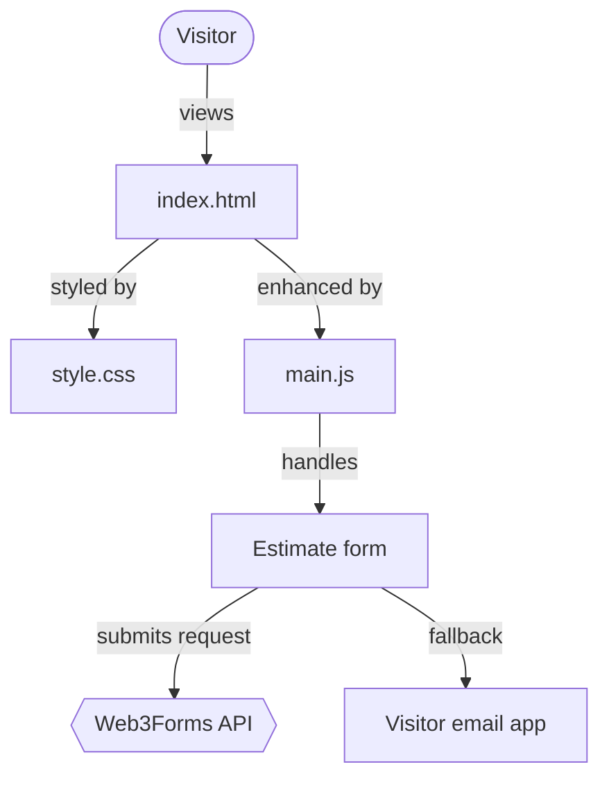

# Mr. Tony Services

Website for Mr. Tony Services (Concord, CA) — HTML, CSS and JavaScript.

## How it works

## Files
- `index.html` — page content
- `css/style.css` — design
- `js/main.js` — menu, animations, estimate form